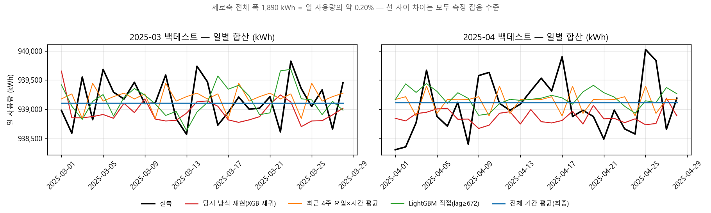

# 스마트팩토리 전력소비 예측 — 공모전 회고와 개선

> **제4회 BDA 채용공모전** 「스마트팩토리 전력소비 예측」에 팀으로 참가했던 프로젝트를,
> 공모전이 끝난 뒤 혼자 처음부터 다시 검증하고 개선한 프로젝트이다.

| | 공모전 (팀) | 개선판 (개인) |
|---|---|---|
| 기간 | 2025.12 ~ 2026.01 | 2026.10 |
| 결과물 | XGBoost 재귀 예측 1종, 4월 1회 검증 | 데이터 진단 리포트, 대회 지표 구현, 모델 11종 백테스트, 최종 예측 |
| 기술 | Python, pandas, XGBoost | + pyarrow, LightGBM, matplotlib |

---

## 📌 요약 (TL;DR)

1. **데이터부터 다시 봤다.** 공장 전력은 약 39,129 kWh/h로 거의 일정했고, 시간별 변동(0.24%)은 측정 잡음 크기와 같았다.
   시간대·요일·공휴일 패턴이 없었고 `operation`은 항상 1이었다. 당시에는 이것을 확인하지 않고 바로 복잡한 모델부터 만들었다.
2. **대회 평가 방식 그대로 백테스트를 만들었다.** 일·주 합산 오차와 요금·탄소 Bell-curve를 코드로 구현하고, 3월·4월 예측과 롤링 9회로 모델 11종을 같은 기준에서 비교했다.
3. **결론은 "가장 단순한 모델이 가장 정확하다"였다.** 학습 기간 전체 평균이 당시 방식(XGBoost 재귀 예측)보다
   주별 오차는 55%, 월 총량 오차는 76% 작았고, 롤링 9회 중 일별 기준 9회 모두 더 정확했다.
   다만 데이터 특성상 **절대적인 차이는 아주 작다**(일별 SMAPE 0.045% → 0.037%). 이 점도 그대로 기록했다.

---

## 1. 과제 소개

- **목표**: 2025년 5월 1일 00시 ~ 5월 28일 23시(672시간)의 공장 전체 시간별 전력량(`hourly_pow`)과
  월 총량(`agg_pow`), 전기요금(`agg_pow × 180원`), 탄소배출량(`agg_pow × 0.424 kgCO₂`) 예측
- **데이터**: 설비 13개의 5초 간격 센서 데이터, 2024.12 ~ 2025.04 (약 3,370만 행, 4.9GB)
  - `activePower`(kW), `accumActiveEnergy`(kWh), `operation`(가동 여부), 전압·전류·역률 등
- **데이터 용도**

  | 구분 | 기간 | 용도 |
  |---|---|---|
  | train | 2024.12 ~ 2025.03 | 모델 학습 |
  | test | 2025.04 | 팀 내부 검증 (4월을 예측해 실측과 비교) |
  | 제출 | 2025.05 (672시간) | 예측값 제출 → 주최측이 비공개 정답으로 평가 |

  당시 코드와 개선판 모두 주최측이 함께 제공한 12~4월 전체 원본(`rtu_data_full.csv`)을 위 기간대로 나눠 사용했다
  (12~3월 구간이 `train.csv`와 완전히 같음을 확인).
- **평가 방식** (주최측 가이드)

  | 항목 | 계산 | 지표 | 비중 |
  |---|---|---|---|
  | 일별 전력 | hourly_pow를 하루 단위로 합산 | MAE·RMSE·SMAPE → 1/(1+오차) | 30% |
  | 주별 전력 | 월요일 시작 주 단위로 합산 | 같음 | 30% |
  | 5월 전기요금 | agg_pow × 180 | 상대오차 Bell-curve | 20% |
  | 5월 탄소배출 | agg_pow × 0.424 | 상대오차 Bell-curve | 20% |

  → 요금과 탄소는 둘 다 월 총량에 상수를 곱한 값이므로, **월 총량 정확도가 사실상 점수의 40%** 를 차지한다.

---

## 2. 나의 역할

**공모전 당시 (팀)**
- 팀원 각자가 모델을 직접 설계·구현하고, 같은 4월 검증 데이터로 성능을 비교해 가장 좋은 모델을 채택하는 방식으로 진행했다.
- 본인도 직접 모델링해 비교에 참여했다. 팀원들의 모델 성능은 서로 큰 차이가 없었고, 그중 **XGBoost + 재귀 예측**을 최종 채택했다.
- 당시 코드는 [`legacy/bda_xgboost.py`](legacy/bda_xgboost.py)에 수정 없이 보존했다. 개선판의 비교 실험에서는 같은 피처·하이퍼파라미터·학습 구간을
  [`models.py`](src/models.py)의 `orig_xgb_recursive`로 재현해 사용했다.

**개선판 (개인, 전 과정 단독 수행)**
- 원본 데이터 재진단 (시간 패턴·단위·변동의 크기·파일 간 일치 여부)
- 대회 평가 지표 구현 및 공개되지 않은 계산식 역산
- 월 단위 백테스트와 롤링 검증 설계, 모델 11종 비교, 최종 예측과 문서화

---

## 3. 당시 결과와 아쉬웠던 점

### 당시 결과
| 항목 | 값 |
|---|---|
| 최종 모델 | XGBoost (lag 1·24·168, 이동평균 24·168, 시간·요일) + 672시간 재귀 예측 |
| 5월 예측 총량 | 26,287,804 kWh (요금 4,731,804,633원 / 탄소 11,146,029 kg) |
| 4월 예측 채점 결과* | 일별 SMAPE 0.042%, 주별 SMAPE 0.023%, 월 총량 오차 −0.014% |
| 공식 점수·순위 | 주최측 미공개 |

\* 당시 만든 4월 예측 파일을 개선판의 평가 함수로 다시 채점한 결과이다 ([outputs/submitted_check.csv](outputs/submitted_check.csv)).

### 아쉬웠던 점 (회고)
| # | 아쉬웠던 점 | 결과적으로 생긴 문제 |
|---|---|---|
| 1 | **데이터를 진단하지 않고 모델부터 만들었다** | 패턴이 없는 데이터라는 걸 몰랐고, 그래서 복잡한 모델이 왜 필요한지 설명하지 못했다 |
| 2 | **검증이 4월 한 번, 그것도 시간 단위 지표 위주였다** | 대회는 일·주 합산과 월 총량으로 채점하는데 검증 기준이 달랐다. 단순 기준 모델과 비교하지도 않았다 |
| 3 | **재귀 예측 구조** | 자기 예측값을 다시 lag_1 입력으로 넣으면서 오차가 한 방향으로 쌓였다(매달 약 −0.02% 과소예측) |
| 4 | **검증 후 4월까지 반영해 다시 학습하는 단계가 없었다** | 4월 예측값을 이어 붙여 5월을 예측해서, 실제로는 3월 말부터 약 1,370시간을 재귀로 예측한 셈이 됐다 |
| 5 | **검증용 마지막 7일이 아무 역할도 하지 않았다** | `eval_set`으로만 넘기고 조기 종료를 쓰지 않아서, 7일치 데이터가 학습에도 검증에도 쓰이지 않았다 |
| 6 | **대용량 처리 비효율** | 청크마다 `iterrows`로 dict에 누적하고, 재귀 한 스텝마다 전체 피처를 다시 계산했다 |

---

## 4. 개선 과정

### Step 1. 데이터 한 번만 읽고 집계 — [`build_hourly.py`](src/build_hourly.py)
- pyarrow 스트리밍으로 4.9GB CSV를 **한 번만** 읽고, 설비×시간 단위로 activePower 평균·표준편차, operation 비율, 누적 전력량 등을 집계했다.
- 3,370만 행을 **49초**에 6.5MB parquet로 줄였고, 이후 모든 실험은 이 파일만 사용한다.

### Step 2. 데이터 진단 — [`inspect_quality.py`](src/inspect_quality.py), [`check_units.py`](src/check_units.py)

| 점검 항목 | 결과 |
|---|---|
| 데이터 품질 | 중복·음수 없음. 데이터는 2025-04-30 00시까지 제공 |
| 파일 간 일치 | `train.csv` = `rtu_data_full.csv`의 3월까지 구간 (행 수·전력 합·누적량 완전 일치) |
| 단위 | 누적 전력량 증가분 ÷ activePower 시간평균 = **1.000** → 가이드 정의(kW·kWh)와 일치 |
| 시간 패턴 | 시간대별·요일별 평균 차이 0.06% 이내, 자기상관 ±0.03 이하 |
| 공휴일 | 설 연휴·성탄절 사용량이 평일과 같음 |
| operation | 전 기간 100% 가동(=1) → 예측에 쓸 정보 없음 |
| **변동의 크기** | 시간별 표준편차(95.8)가 5초 샘플 잡음만으로 생기는 크기(96.3)와 같음 → **예측 가능한 신호가 거의 없음** |

자세한 내용: [reports/data_quality.md](reports/data_quality.md), [reports/units.md](reports/units.md)

### Step 3. 대회 평가 지표 구현 — [`metrics.py`](src/metrics.py)
- 일·주 합산(월요일 시작, 5월 양 끝의 부분 주 포함), MAE·RMSE·SMAPE, Bell-curve를 그대로 구현했다.
- 가이드에 식이 없는 Bell-curve는 예시 수치로 역산했다(트러블슈팅 ④).

### Step 4. 같은 기준으로 모델 비교 — [`models.py`](src/models.py), [`backtest.py`](src/backtest.py)
- **월 단위 백테스트**: ~2월 학습 → 3월 1~28일 예측, ~3월 학습 → 4월 1~28일 예측 (대회와 같은 672시간)
- **롤링 검증**: 2/1 ~ 4/1 매주 시작점을 바꿔 9번 반복 → 순위가 잡음 때문에 바뀌는지 확인
- **잡음 하한**: 정답의 월평균을 미리 안다고 가정한 상수 예측(`oracle_flat`)을 넣어, 어떤 모델도 넘을 수 없는 선을 표시
- 비교한 모델

  | 분류 | 모델 |
  |---|---|
  | 당시 방식 재현 | XGBoost + lag_1 재귀 예측 (하이퍼파라미터·피처·학습 구간 원본 그대로) |
  | 단순 기준 | 최근 4주 요일×시간 평균 / 최근 4주 평균 / 학습 기간 전체 평균 / 전체 평균 + 휴일 보정 |
  | 직접 예측 | XGBoost·LightGBM (4·5·6주 전 같은 시각 값 등 **예측 시점에 이미 알려진 값만** 사용, 재귀 없음) |
  | 변수 실험 | LightGBM + 공휴일 / + operation / 설비별 학습 후 합산 |

---

## 5. 결과

### 5-1. 월 단위 백테스트 (3월·4월 평균)

| 모델 | 일별 SMAPE | 주별 SMAPE | 월 총량 오차 | 점수(추정) |
|---|---:|---:|---:|---:|
| (참고) 잡음 하한 `oracle_flat` | 0.0366% | 0.0135% | 0.000% | 0.99074 |
| ✅ **학습 기간 전체 평균 (최종 채택)** | **0.0369%** | **0.0135%** | **0.005%** | **0.99072** |
| 최근 4주 요일×시간 평균 | 0.0399% | 0.0135% | 0.006% | 0.99071 |
| LightGBM 설비별 학습 | 0.0404% | 0.0176% | 0.006% | 0.99070 |
| XGBoost 직접 예측 | 0.0407% | 0.0177% | 0.010% | 0.99067 |
| LightGBM 직접 예측 | 0.0429% | 0.0191% | 0.007% | 0.99067 |
| 당시 방식 재현 (XGBoost 재귀) | 0.0445% | 0.0298% | 0.021% | 0.99058 |

<details>
<summary>전체 11개 모델 결과 보기</summary>

| 모델 | 설명 | 일별 SMAPE | 주별 SMAPE | 월 총량 오차 | 시간 MAE (kWh) | 소요 |
|---|---|---:|---:|---:|---:|---:|
| `oracle_flat` | (참고) 정답 월평균을 상수로 예측 | 0.0366% | 0.0135% | 0.000% | 77.3 | – |
| `base_mean_all_hol` | 전체 평균 + 과거 휴일 비율 보정 | 0.0368% | 0.0154% | 0.004% | 77.4 | 0.002s |
| `base_mean_all` | 학습 기간 전체 평균 | 0.0369% | 0.0135% | 0.005% | 77.3 | 0.001s |
| `base_mean_4w` | 최근 4주 평균 | 0.0372% | 0.0138% | 0.006% | 77.3 | 0.001s |
| `base_dowhour_4w` | 최근 4주 요일×시간 평균 | 0.0399% | 0.0135% | 0.006% | 84.6 | 0.003s |
| `lgbm_direct_module` | LightGBM 설비별 학습 → 합산 (+공휴일) | 0.0404% | 0.0176% | 0.006% | 78.1 | 0.50s |
| `xgb_direct` | XGBoost 직접 예측 | 0.0407% | 0.0177% | 0.010% | 80.2 | 0.17s |
| `lgbm_direct_hol` | LightGBM 직접 + 공휴일 | 0.0427% | 0.0193% | 0.007% | 82.1 | 0.15s |
| `lgbm_direct` | LightGBM 직접 예측 | 0.0429% | 0.0191% | 0.007% | 82.0 | 0.14s |
| `lgbm_direct_op` | LightGBM 직접 + operation | 0.0429% | 0.0191% | 0.007% | 82.0 | 0.14s |
| `orig_xgb_recursive` | 당시 방식 재현 | 0.0445% | 0.0298% | 0.021% | 82.6 | 1.80s |

원본 수치: [outputs/backtest_summary.csv](outputs/backtest_summary.csv), [outputs/backtest_detail.csv](outputs/backtest_detail.csv)
</details>

### 5-2. 롤링 검증 9회 — 순위가 우연이 아닌지 확인

| 모델 | 일별 SMAPE | 주별 SMAPE | 월 총량 오차 | 당시 방식보다 정확했던 횟수 (일별 · 주별) |
|---|---:|---:|---:|:---:|
| ✅ **학습 기간 전체 평균** | **0.0365%** | **0.0168%** | **0.007%** | **9/9 · 8/9** |
| 최근 4주 평균 | 0.0380% | 0.0188% | 0.011% | 9/9 · 8/9 |
| LightGBM 직접 예측 | 0.0404% | 0.0210% | 0.010% | 7/9 · 5/9 |
| LightGBM 설비별 학습 | 0.0419% | 0.0196% | 0.009% | 5/9 · 6/9 |
| 최근 4주 요일×시간 평균 | 0.0421% | 0.0197% | 0.011% | 6/9 · 7/9 |
| 당시 방식 재현 | 0.0439% | 0.0257% | 0.018% | – |

### 5-3. 당시 실제 4월 예측 파일과의 비교 (4/1 ~ 4/28)

| | 일별 SMAPE | 주별 SMAPE | 월 총량 오차 |
|---|---:|---:|---:|
| 당시 실제 4월 예측 파일 | 0.0424% | 0.0232% | −0.014% |
| 당시 방식 재현 모델 | 0.0480% | 0.0281% | −0.021% |
| **개선판 (전체 평균)** | **0.0421%** | **0.0138%** | **+0.005%** |

재현 모델은 당시 결과와 같은 수준이고, 과소예측 방향도 같다. 그래서 재현이 원본의 특성을 잘 따라갔다고 판단했다.



### 5-4. 해석
- **최종 모델은 학습 기간 전체 평균이다.** 데이터에 예측할 패턴이 없으니, 가장 긴 기간의 평균이 잡음을 가장 잘 상쇄한다.
  월 단위 백테스트에서 잡음 하한(`oracle_flat`) 바로 위에 있었다(일별 SMAPE 0.0369% vs 0.0366%).
- **복잡한 모델은 잡음을 학습했다.** GBM 계열은 두 검증 모두에서 평균 모델들보다 일관되게 오차가 컸고, 요일×시간 평균과 비슷한 수준이었다.
  당시 팀원들이 각자 만든 모델의 성능이 서로 비슷했던 것도 같은 이유이다. 신호가 없는 데이터에서는 어떤 모델이든 평균 근처로 모인다.
- **operation·공휴일·설비별 학습은 효과가 없었다.** `lgbm_direct_op`은 `lgbm_direct`와 지표가 완전히 같았는데(operation이 항상 1), 데이터 진단 결과와 맞다.
- **정직하게 말하면, 개선 폭은 절대값으로 작다.** 모든 모델의 추정 점수는 0.9906~0.9907로, 당시 모델도 이미 상한에 가까웠다.
  이 프로젝트에서 얻은 것은 점수보다 **"왜 이 모델인가"를 근거로 설명할 수 있는 검증 체계**이다.

### 5-5. 최종 5월 예측 — [`predict_may.py`](src/predict_may.py)
3월·4월 검증으로 모델을 고른 뒤, 4월 실측까지 포함한 전체 기간(2024-12-01 ~ 2025-04-29, 3,600시간)으로 다시 학습했다.
당시처럼 4월 예측값을 이어 붙이지 않았고, 재귀 예측도 쓰지 않는다.

| 항목 | 당시 제출 | 개선판 |
|---|---:|---:|
| hourly_pow | 38,956 ~ 39,239 (시간마다 다름) | 39,129.4 (고정) |
| agg_pow (kWh) | 26,287,804 | **26,294,942** (+0.027%) |
| may_bill (원) | 4,731,804,633 | **4,733,089,614** |
| may_carbon (kgCO₂) | 11,146,029 | **11,149,056** |

---

## 6. 트러블슈팅

<details open>
<summary><b>① 전기량 컬럼끼리 맞지 않음 → 단위 정의를 무엇으로 확인할 것인가</b></summary>

- **문제**: 전압 × 전류 × 역률로 계산한 전력이 `activePower`의 약 3.47배였다. 그래서 activePower 단위(kW인지 W인지)를 의심했다.
- **확인**: 실제로 측정이 쌓이는 `accumActiveEnergy`의 시간당 증가분과 비교하니 activePower 시간평균과 **정확히 1.000배**였다.
  activePower(kW) × 1h = 누적 전력량 증가(kWh)이므로 가이드 정의, 원본 코드, 데이터가 서로 일관된다.
- **판단**: 조명·호이스트·분쇄기 등 성격이 다른 13개 설비가 모두 같은 분포(평균 약 3,010, 표준편차 약 716)를 가진 점을 보면 시뮬레이션 데이터로 보인다.
  그래서 물리 법칙으로 단위를 역추정하지 않고 **주최측 정의 + 데이터 내부 정합성**을 기준으로 삼았다. 맞지 않는 전기량 컬럼은 피처에서 뺐다.
</details>

<details>
<summary><b>② 모델 간 차이가 너무 작다 → 순위가 의미 있는지부터 검증</b></summary>

- **문제**: 3월·4월 백테스트에서 모든 모델의 차이가 0.01%p 수준이었다. 이 정도면 fold 두 개만으로는 순위가 우연일 수 있다.
- **해결**:
  1. 정답 월평균을 미리 안다고 가정한 `oracle_flat`으로 **잡음 하한**을 계산 → 최상위 모델이 하한 바로 위에 있음을 확인
  2. 시작점을 9개로 늘린 **롤링 검증** → 전체 평균이 당시 방식보다 일별 기준 9/9회 더 정확
  3. 5초 샘플이 독립인 잡음이라고 가정해 이론적인 시간별 표준편차(96.3)를 계산 → 실제 표준편차(95.8)와 같음 = 신호가 없다는 근거
</details>

<details>
<summary><b>③ 평가식 일부가 공개되지 않음 → 예시 수치로 역산</b></summary>

- **문제**: 가이드에는 Bell-curve의 예시만 있었다(기준 10%, 표준편차 5% → 오차 10%면 0.5점, 20%면 0.022점, 30% 이상이면 거의 0점).
- **해결**: `점수 = 1 − Φ((|상대오차| − 10%) / 5%)` (정규분포 생존함수)가 예시와 정확히 일치했다(10% → 0.5000, 20% → 0.0228).
- **남은 가정**: 일·주 점수에서 MAE·RMSE 원값(수백 kWh)을 1/(1+오차)에 그대로 넣으면 모든 모델이 0점 근처라 비교가 안 된다.
  그래서 실측 평균으로 나눈 상대값을 쓴 **추정 점수**로 비교했고, 모델 순위는 단위와 무관한 SMAPE·상대오차로 판단했다.
</details>

<details>
<summary><b>④ 4/30 데이터 없음 → 예측 시작 직전의 빈 구간 처리</b></summary>

- **문제**: 데이터가 4/30 00:00:00 샘플 하나에서 끝난다. 당시 코드는 이 한 샘플의 평균을 4월 실측 한 시간으로 썼다.
  또 5월 예측에 4주 전 값을 쓰려면 5/28 23시의 4주 전인 4/30 23시가 필요한데, 이 값이 없다.
- **해결**: 한 시간 중 샘플이 50% 미만인 시간은 제외했고, lag 모델은 빈 시간을 최근 4주 요일×시간 평균으로 채운 뒤 피처를 만들었다.
</details>

<details>
<summary><b>⑤ 4.9GB CSV를 실험마다 다시 읽는 비용</b></summary>

- **문제**: 당시 코드는 실행할 때마다 원본 전체를 다시 읽었고, 청크마다 `iterrows`로 Python dict에 누적했다.
- **해결**: pyarrow 스트리밍 + 배치별 groupby 부분집계 → 마지막에 한 번 병합. 3,370만 행을 **49초**에 집계해 6.5MB parquet로 저장했고, 이후 실험은 1분 안에 끝난다.
</details>

---

## 7. 배운 점

- **모델보다 데이터가 먼저이다.** 패턴이 없는 데이터에서는 어떤 모델도 평균을 이기기 어렵다. 시간대·요일별 평균만 먼저 그려 봤어도 방향이 달라졌을 것이다.
- **기준 모델 없이는 "좋은 모델"을 말할 수 없다.** 당시에는 팀원들의 모델끼리만 비교했고, 단순 평균과는 비교하지 않았다.
- **평가 지표와 검증 지표를 맞춰야 한다.** 대회는 일·주 합산과 총량으로 채점하는데, 당시에는 시간 단위 오차로만 모델을 골랐다.
- **차이가 작을 때는 그 차이가 의미 있는지부터 확인해야 한다.** 잡음 하한과 반복 검증이 그 도구이다.

---

## 📁 폴더 구조

```
스마트팩토리/                     # ← 이 프로젝트
├─ legacy/
│  └─ bda_xgboost.py              # 공모전 당시 코드 (수정 없이 보존)
├─ src/
│  ├─ build_hourly.py             # Step 1  원본 CSV → data/hourly.parquet (1회 읽기)
│  ├─ inspect_quality.py          # Step 2  데이터 품질·시간 패턴·파일 간 일치 점검
│  ├─ check_units.py              # Step 2  activePower ↔ 누적 전력량 단위 점검
│  ├─ metrics.py                  # Step 3  대회 평가 지표 + 제출 포맷
│  ├─ data.py                     #         parquet 로딩, 원본 경로(RAW_DATA_DIR), 공휴일 목록
│  ├─ models.py                   # Step 4  당시 방식 재현 / 기준 모델 / 직접 예측 GBM
│  ├─ backtest.py                 # Step 4  월 단위 백테스트 + 롤링 검증 + 당시 파일 채점 + 그림
│  └─ predict_may.py              # Step 5  최종 모델로 5월 예측 파일 생성
├─ reports/                       # data_quality.md, units.md, raw_profile*.json
├─ outputs/                       # 백테스트 결과 CSV, figures/
└─ data/                          # (git 제외) hourly.parquet

RAW_DATA_DIR/                     # (git 제외, 저장소 밖) 주최측 원본 데이터
├─ rtu_data_full.csv              # 필수
├─ train.csv                      # 선택: 원본과 공식 학습 데이터 일치 확인용
└─ xgboost_result.csv / xgboost_result_april.csv   # 선택: 당시 5월 제출 / 4월 예측 결과 비교용
```

## ▶️ 실행 방법

> ⚠️ **데이터는 저장소에 포함되어 있지 않다.** 공모전 주최측 배포 자료(약 9.5GB)라 재배포하지 않으며,
> `.gitignore`로 `data/`, `*.csv`, `*.parquet` 등을 제외했다(결과 요약 CSV만 예외).
> 원본 파일이 있는 폴더를 환경변수 `RAW_DATA_DIR`로 지정한다(지정하지 않으면 이 폴더의 상위 폴더에서 찾는다).

```bash
pip install -r requirements.txt
export RAW_DATA_DIR="/path/to/원본데이터"     # PowerShell: $env:RAW_DATA_DIR = "C:\path\to\원본데이터"

python src/build_hourly.py                                  # 1. 집계 (약 1분)
python src/inspect_quality.py                               # 2. 데이터 품질 리포트
python src/check_units.py                                   #    단위 점검 리포트
python src/metrics.py                                       # 3. 평가 지표 자체 점검
python src/backtest.py                                      # 4. 백테스트 (약 1분)
python src/predict_may.py                                   # 5. 5월 예측 → outputs/submission_may.csv
```

`train.csv`와의 일치 여부까지 확인하려면 `inspect_quality.py` 전에 다음을 실행한다.
```bash
python src/build_hourly.py --raw_csv "$RAW_DATA_DIR/train.csv" --out data/hourly_traincsv.parquet --profile_out reports/raw_profile_traincsv.json
```

## ⚖️ 한계
- 일·주 점수의 정확한 계산식은 공개되지 않아 추정 점수를 썼다. 그래서 모델 순위는 SMAPE와 상대오차로 판단했다.
- 주어진 데이터는 사실상 일정한 값에 잡음만 있어서, 모델링 기법의 우열을 가리기에는 변별력이 낮다.
  가동 스케줄·휴무·계절 패턴이 있는 실제 공장 데이터라면 직접 예측 GBM + operation/공휴일 피처가 유리할 수 있다.
  이 프로젝트의 검증 틀(대회 지표, 동일 기준 백테스트, 롤링 검증, 잡음 하한)은 그런 데이터에도 그대로 쓸 수 있다.
- 5월 실제 정답이 공개되지 않아 최종 점수는 확인할 수 없다.
